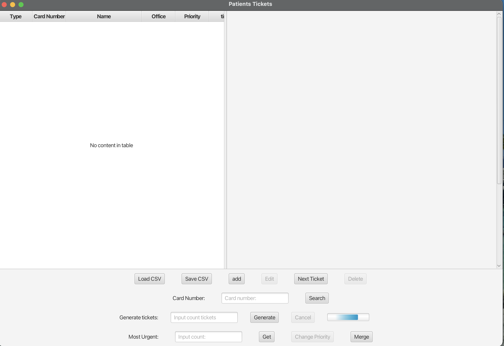
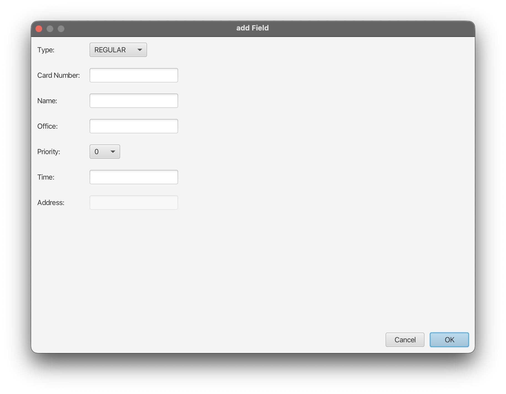
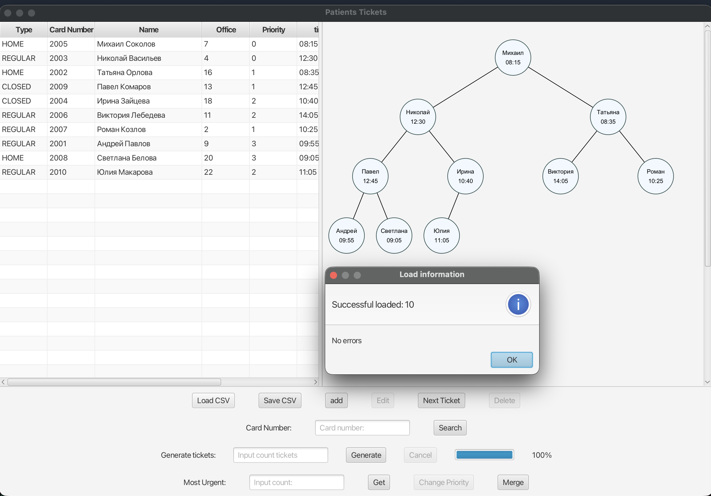
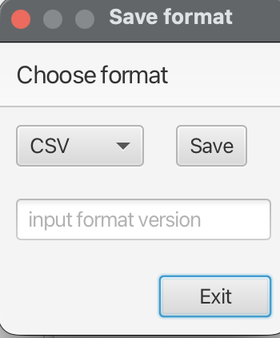
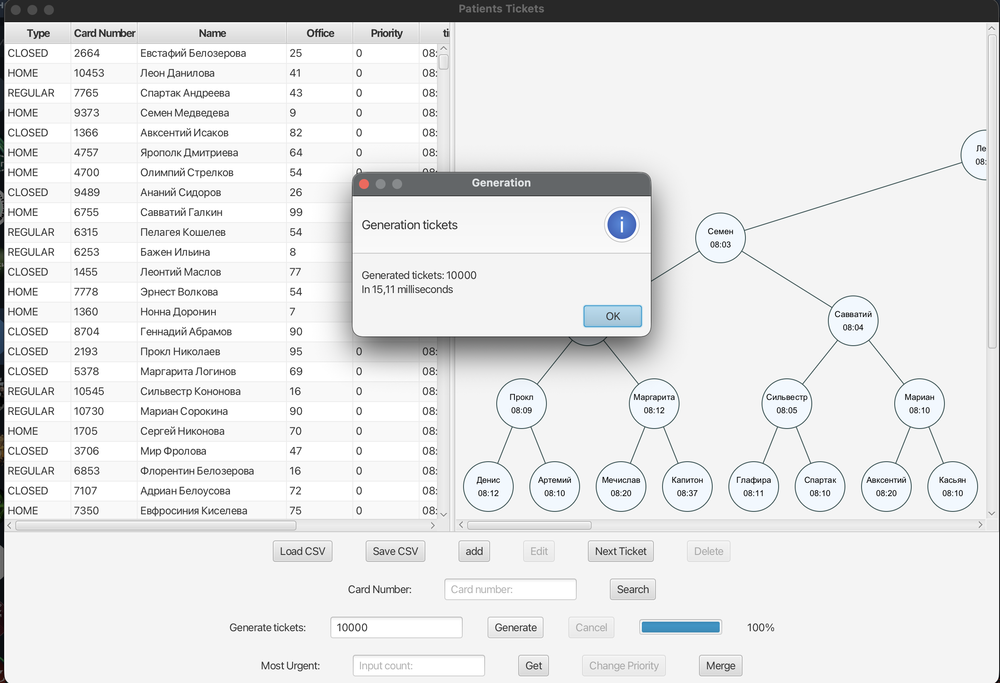
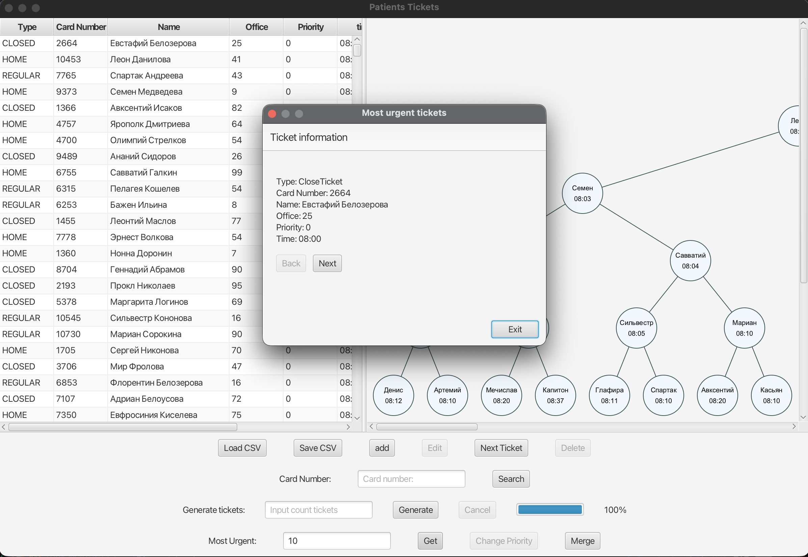

# Clinic Queue Java

Учебный проект на Java, реализующий электронную очередь поликлиники.

Лабораторная работа №4 по дисциплине «Программирование на Java». Вариант №6 — «Электронная очередь поликлиники».

Основная задача — реализация очереди с приоритетами на основе собственной бинарной min-heap (минимальной кучи) с графическим интерфейсом JavaFX.

В ЛР4 добавлены версии схемы данных, миграция старых файлов и сохранение в предыдущие версии CSV, JSON и BIN.

## Возможности

- Добавление, удаление, поиск и редактирование талонов
- Обслуживание следующего пациента с учётом приоритета
- Изменение приоритета талона
- Получение K наиболее срочных талонов
- Объединение двух очередей
- Загрузка и сохранение данных в CSV, JSON и BIN
- Чтение схем v1, v2 и v3 с переходом к текущей версии v3
- Сохранение в v1 или v2 с предупреждением о потере новых полей
- Генерация случайных талонов
- Визуализация бинарной кучи с подсветкой посещённых вершин
- Фоновая загрузка, сохранение и генерация данных с отображением прогресса

## Типы талонов

В программе используются три типа талонов:

- `REGULAR` — обычный талон
- `HOME` — вызов на дом с указанием адреса
- `CLOSED` — закрытый талон, недоступный для редактирования

Каждый талон содержит номер карты, ФИО пациента, номер кабинета, приоритет и время. В схеме v2 добавлен комментарий `comment`, в v3 — признак подтверждения `confirmed`.

Приоритет принимает значения от 0 до 3, где 0 — наиболее срочный. Если приоритеты совпадают, первым обслуживается пациент с более ранним временем.

## Структура данных

Для хранения талонов реализован собственный обобщённый класс `BinHeap<T>`.

Куча построена на массиве. При добавлении и удалении элементов используются операции `siftUp` и `siftDown`.

Основные операции:

- Добавление элемента
- Извлечение минимального элемента
- Поиск элемента
- Удаление элемента по значению
- Изменение позиции элемента по индексу

## Сериализация и версии данных

Для JSON и BIN используется общий интерфейс `Serializer` с методами `save`, `load` и `format`. Класс `JsonSerializer` работает через Jackson, `BinSerializable` — через стандартную сериализацию Java. CSV обрабатывается классами `CsvLoader`, `CsvSaver` и `CsvTicketHandler`.

Текущая версия схемы — **3**, поддерживаются версии **1–3**.

| Версия файла | Содержимое | Дополнение при загрузке в v3 |
|---|---|---|
| v1 | Тип, номер карты, ФИО, кабинет, приоритет, время; адрес для HOME | `comment = "None"`, `confirmed = false` |
| v2 | Поля v1 и `comment` | `confirmed = false` |
| v3 | Поля v2 и `confirmed` | Дополнение не требуется |

Версия хранится в самом файле:

- JSON — поле `schema_version` рядом с массивом `tickets`
- CSV — первая строка `#schema_version=N`, разделитель полей — `;`
- BIN — номер версии в заголовке потока; `Ticket.writeObject` и `Ticket.readObject` записывают и читают поля с учётом версии

Для JSON переходы v1 → v2 → v3 и обратные переходы вынесены в `MigrationManager`. CSV и BIN читают набор полей соответствующей версии и дополняют старые записи значениями по умолчанию.

При открытии файла v1 или v2 через `Load` программа запрашивает подтверждение миграции. Такое же подтверждение есть при объединении с очередью из CSV через `Merge`. При отказе текущая очередь сохраняется.

Для сохранения нужно нажать `Save`, выбрать CSV, JSON или BIN и ввести версию `1`, `2` или `3`. Пустое поле версии не принимается. При выборе старой версии появляется предупреждение:

- Сохранение в v2 исключает `confirmed`
- Сохранение в v1 исключает `comment` и `confirmed`

Эти поля исключаются только из сохраняемого файла. Талоны в текущей очереди не изменяются.

При загрузке проверяются версия и обязательные данные талонов; JSON дополнительно проверяется на корректные типы полей. Неподдерживаемые версии отклоняются. Текущая очередь заменяется после успешного чтения JSON/BIN и подтверждения миграции, если она нужна. Ошибки строк CSV записываются в отдельный файл, остальные корректные строки можно загрузить.

CSV не использует экранирование разделителя и переносов строк. Перед сохранением проверяются ФИО, адрес HOME и комментарий, если он входит в выбранную версию. Если в них есть `;`, `\r` или `\n`, сохранение отклоняется до открытия выходного файла.

## Демонстрация работы

Окно выбора формата показано для ЛР4. Остальные снимки демонстрируют базовые операции, реализованные на предыдущем этапе проекта.

### Главное окно

Таблица талонов и визуализация бинарной кучи.



### Добавление талона

При добавлении нового талона можно выбрать его тип, указать данные пациента, кабинет, приоритет и время приёма. Для талона HOME дополнительно указывается адрес.



### Загрузка из CSV

После загрузки отображается количество успешно прочитанных талонов и информация об ошибках. Ошибки сохраняются в отдельном файле. Загрузка выполняется в фоновом потоке.



### Выбор формата сохранения

При сохранении очереди можно выбрать CSV, JSON или BIN и указать версию схемы от 1 до 3.



### Генерация талонов

Программа позволяет генерировать заданное количество талонов. Генерация выполняется в отдельном потоке.



### Наиболее срочные талоны

Операция позволяет получить K наиболее срочных талонов без изменения исходной очереди.



## Эксперименты и сравнение

В проекте также реализованы отдельные классы для проверки работы структуры данных:

- `HeapBenchmark` — измерение времени основных и дополнительных операций на 10 000 и 100 000 элементах
- `HeapComparison` — сравнение собственной кучи со стандартной `PriorityQueue`
- `HeapConcurrencyDemo` — демонстрация гонки потоков при одновременной записи и её устранения с помощью `synchronized`
- `Lab3Benchmark` — сравнение времени сохранения, загрузки и размера JSON/BIN для 10 000 талонов

Эксперименты находятся в пакете `lab2.experiment`.

## Структура проекта

Основной код находится в `src/main/java/lab2`:

- `tickets` — модель талонов и типы REGULAR, HOME, CLOSED
- `heap` — собственная обобщённая бинарная куча
- `gui` — окна JavaFX, таблица и визуализация кучи
- `generator` — генерация талонов и фоновая задача
- `io` — чтение и запись CSV
- `io/serializable/json` — JSON и миграции
- `io/serializable/binary` — BIN и потоки с версией
- `exception` — ошибки загрузки и сериализации
- `experiment` — измерения и сравнения

JUnit-тесты находятся в `src/test/java`, тестовые файлы — в `src/test/resources/testsFiles`. Название базового пакета `lab2` сохранено при развитии проекта в следующих лабораторных.

## Технологии

- Java 25
- JavaFX 25
- Gradle
- CSV, JSON и BIN
- Jackson
- JUnit 5

## Запуск

Для запуска необходим установленный JDK 25. Gradle используется через Wrapper, JavaFX и остальные зависимости загружаются при первой сборке.

Клонировать репозиторий и перейти в папку проекта:

```bash
git clone https://github.com/EgorKubakin/clinic-queue-java.git
cd clinic-queue-java
```

На macOS и Linux:

```bash
./gradlew run
```

На Windows в PowerShell:

```powershell
.\gradlew.bat run
```

## Сборка и тесты

| Действие | macOS / Linux | Windows PowerShell |
|---|---|---|
| Сборка, включая тесты | `./gradlew clean build` | `.\gradlew.bat clean build` |
| Только тесты | `./gradlew test` | `.\gradlew.bat test` |

В проекте есть JUnit 5-тесты для добавления и извлечения из кучи, CSV, JSON/BIN и миграций. Проверяются сохранение и обратная загрузка талонов, пустая очередь, неподдерживаемая версия, отдельные некорректные файлы, чтение v1/v2 с заполнением новых полей и сохранение данных при чтении v3.

HTML-отчёт после запуска тестов: `build/reports/tests/test/index.html`.

GitHub Actions автоматически выполняет чистую сборку и JUnit-тесты на JDK 25 при изменениях в `main`, `lab4` и при создании Pull Request в `main`.
